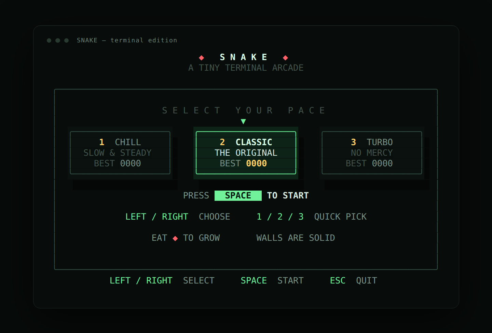

# SNAKE 4 · 本地与 MQTT 双人终端贪吃蛇

一个用 **C# / .NET 10** 编写的双人终端贪吃蛇。既支持同一台机器上的本地对战，也支持通过 **MQTT 5** 联机，网络消息使用 **Protobuf** 编码。两名玩家共享同一张棋盘和食物，各自拥有独立的移动速度、等级与主动加速技能。



## 运行

需要 [.NET SDK 10.0](https://dotnet.microsoft.com/download)，以及支持 UTF-8 / 24 位色的交互式终端。项目通过 NuGet 引入 MQTTnet 5.2、Google.Protobuf 和 Grpc.Tools。

```bash
cd /home/yukiko/Project/Lab/snake
dotnet run
```

终端至少需要 **76 × 22** 个字符，推荐 80 × 24 或更大。窗口过小时游戏会自动冻结并提示调整大小。

## 本地双人

```bash
dotnet run
```

- 主菜单用 `←` / `→` 或 `A` / `D` 选择难度
- `1` / `2` / `3` 直接选择 CHILL / CLASSIC / TURBO
- `Space` / `Enter` 开始

| 玩家 | 移动 | 加速技能 |
| --- | --- | --- |
| **P1（绿色）** | `W` `A` `S` `D` | `E` |
| **P2（蓝色）** | 方向键 | `O` |

游戏中 `P` / `Esc` 暂停；结束后 `Space` / `Enter` / `R` 再来一局，`M` 回菜单，`Q` 退出。

## MQTT 联机

联机采用 **Host 权威 + Protobuf** 模式：

```text
Host：运行完整游戏模拟，定期发布棋盘快照
Guest：不运行模拟，只发送输入并渲染 Host 的快照
```

### 1. 启动 Host

```bash
dotnet run -- --host
```

Host 会连接默认 broker `broker.emqx.io:1883`，创建随机房间码并显示在联机大厅里。

也可以指定房间、难度和本地 broker：

```bash
dotnet run -- --host --room TEST1 --difficulty classic --broker localhost:1883
```

### 2. 启动 Guest

在另一台终端或另一台电脑上：

```bash
dotnet run -- --join TEST1 --broker localhost:1883
```

如果 Host 连接的是默认 broker，省略 `--broker` 即可：

```bash
dotnet run -- --join TEST1
```

Guest 加入后对局自动开始。

### 离线测试（本机 Mosquitto）

```bash
# 终端 1：启动 broker
mosquitto -p 1883

# 终端 2：Host
dotnet run -- --host --room TEST1 --broker localhost:1883

# 终端 3：Guest
dotnet run -- --join TEST1 --broker localhost:1883
```

### 联机操作

| 角色 | 移动 | 加速技能 |
| --- | --- | --- |
| **Host / P1** | `W` `A` `S` `D` | `E` |
| **Guest / P2** | 方向键 | `O` |

- `Esc`：退出联机
- 结算后 `Enter` / `Space` / `R`：请求或发起重赛
- 联机模式暂不支持暂停，避免双方的模拟时间不一致

### Broker 配置

```bash
--broker HOST[:PORT]
```

默认连接 `broker.emqx.io:1883`。也可以设置环境变量：

```bash
export SNAKE_MQTT_BROKER=localhost:1883
```

当前版本使用未加密的 MQTT TCP 连接，也没有 broker 用户名/密码认证。公共 broker 上的房间码不是安全边界，不要传输敏感数据；正式使用请换成自己的 broker 并谨慎处理房间码。

## 启动参数

```bash
dotnet run                                   # 本地双人
dotnet run -- --host                         # 创建 MQTT 房间
dotnet run -- --host --room CODE             # 指定房间码
dotnet run -- --join CODE                    # 加入 MQTT 房间
dotnet run -- --broker HOST[:PORT]           # 指定 broker
dotnet run -- --difficulty chill|classic|turbo
dotnet run -- --no-color
dotnet run -- --self-test
dotnet run -- --version
dotnet run -- --help
```

`--` 是让 `dotnet run` 把后续参数转交给游戏。

## MQTT 5 + Protobuf 消息设计

- 主题前缀：`snake/v4/{room}/...`
- Host → Guest：`host` 主题，发布 Protobuf 编码的完整 `state` 快照
- Guest → Host：`guest` 主题，发布 Protobuf 编码的 `hello`、`input`、`rematch`
- 快照约每 **50 ms** 发送一次，包含：
  - 棋盘、食物、难度
  - 两条蛇的身体、分数、等级、存活状态
  - 加速技能的剩余时间与速度倍率
  - 胜负结果与序列号
- Guest 会忽略比自己已收到快照更旧的序列号

所有 MQTT 负载都是二进制 Protobuf，不使用 JSON。协议定义在 `Protocol/snake.proto`，构建时由 `Grpc.Tools` 生成 C# 类型。MQTT 客户端使用 MQTTnet 5.2 的 `MqttClientFactory` API，并显式使用 MQTT 5.0 协议。

联机时 Host 的主循环仍按 **5 ms 固定步长**模拟；Guest 只负责输入与显示，不自行推进世界。

## 玩法

- 两名玩家共享一颗食物；吃到食物 **+10 分**，身体增长一节。
- 每名玩家 **每吃 4 颗食物升一级**，缩短自己的移动间隔。
- 撞墙、撞到自己或撞到对方身体都会死亡；蛇尾正在移开的格子可以安全进入。
- 两条蛇同时撞上同一格、发生头对头或头交换碰撞时判定为 **DRAW**。
- 一方死亡时另一方立刻获胜；没有时间限制。
- 三档难度：CHILL / CLASSIC / TURBO。

## 主动加速技能

- **持续 2 秒**，移动间隔缩短为当前速度的约 55%（约 `1.8x`）。
- **冷却 7 秒**，从按下技能开始计算。
- HUD 显示 `BOOST` / `COOLDOWN` / `BOOST READY`。
- 加速只提高移动频率，每次逻辑步仍然只移动一格。

## 最高分

本地对战会按难度保存最高分，取双方本局得分中的较高者：

- Linux：`${XDG_DATA_HOME:-~/.local/share}/snake-terminal/highscores.txt`
- Windows：`%LOCALAPPDATA%\snake-terminal\highscores.txt`

MQTT 联机对局不会写入本地最高分。

## 自检

```bash
dotnet run -- --self-test
```

自检覆盖本地双人逻辑、碰撞与加速、菜单/HUD/结算布局、最高分持久化，以及 Protobuf MQTT 快照的序列化/反序列化和联机结算界面。当前 **10 项全部通过**。

## 项目结构

| 文件 | 职责 |
| --- | --- |
| `Program.cs` | 入口、CLI 参数、broker/房间解析 |
| `GameApp.cs` | 本地双人主循环、输入、暂停/重开 |
| `GameWorld.cs` | 共享棋盘、食物、双人碰撞、胜负判定 |
| `SnakePlayer.cs` | 单条蛇的身体、转向、等级、速度与技能冷却 |
| `NetworkGameApp.cs` | MQTT Host/Guest 会话、大厅、快照广播与远程输入 |
| `MqttTransport.cs` | MQTTnet 连接、订阅、发布与入站消息队列 |
| `NetworkProtocol.cs` | MQTT v4 主题与 Protobuf 枚举映射 |
| `Protocol/snake.proto` | MQTT 消息与快照的 Protobuf schema |
| `ProtocolViews.cs` | Protobuf 快照的渲染适配与采集 |
| `IGameView.cs` | 实时世界与 Guest 快照共用的渲染接口 |
| `Ui/GameRenderer.cs` | 菜单、HUD、棋盘、暂停/结算界面 |
| `Ui/Canvas.cs` | 字符画布与 ANSI 真彩色渲染 |
| `Ui/TerminalSession.cs` | 备用屏幕、居中输出、窗口尺寸与终端恢复 |
| `HighScoreStore.cs` | 本地最高分持久化 |
| `SelfTest.cs` | 内置无依赖测试 |

## Git 版本

- `v1.0`：单人版
- `v2.0`：本地双人对战、独立速度、主动加速技能
- `v3.0`：MQTT 主机权威联机、大厅、远程输入、在线结算与重赛
- `v4.0`：MQTTnet 5.2 / MQTT 5.0、Protobuf 二进制消息、Protobuf 快照

```bash
git log --oneline --decorate
git tag
```

## 构建与发布

```bash
dotnet build
dotnet publish -c Release -o publish
./publish/SnakeGame
```

Windows 上发布后运行 `publish\SnakeGame.exe`。
